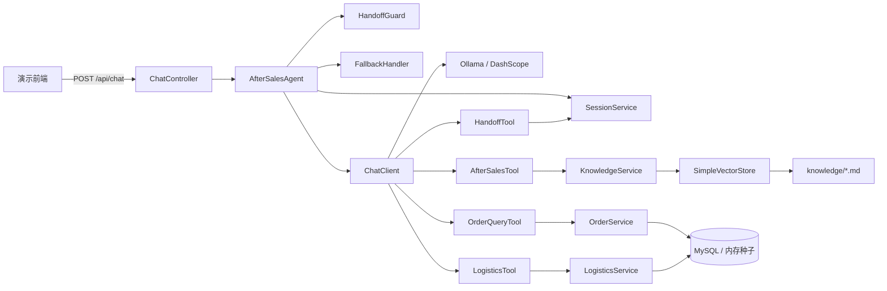

# 星河商城售后智能客服 Agent

基于 Spring AI 的电商售后客服 Agent。用户可以用自然语言查询订单、查询物流、咨询售后政策，必要时转接人工客服。项目同时提供内存与 MySQL 两套数据源、本地 Ollama 与云端 DashScope 两种模型接入，以及一套可量化的评测体系。

> 说明：本项目使用演示数据，商品、订单、用户均为虚构，仅用于学习与作品展示。

## 核心能力

| 能力 | 实现 | 状态 |
| --- | --- | --- |
| 订单查询 | `OrderQueryTool`：订单列表、按订单号查询 | 已完成 |
| 物流查询 | `LogisticsTool`：承运商、运单号、轨迹、退货物流 | 已完成 |
| 售后政策问答 | `AfterSalesTool` + Markdown 知识库向量检索 | 已完成 |
| 多轮对话 | 会话内滑窗历史（默认 10 轮） | 已完成 |
| 转人工 | 关键词识别 + 模型工具调用 + 工单号 | 已完成 |
| 用户隔离 | 工具层注入用户身份，查询强制带 userId | 已完成 |
| 本地 / 云端模型 | Ollama 与 DashScope 双 profile | 已完成 |
| 内存 / MySQL 数据源 | `!mysql` 与 `mysql` 双 profile | 已完成 |
| 评测体系 | 66 条用例 + 规则判分 + 可选 LLM 判分 | 已完成 |
| 流式输出 | SSE | 待实现 |

## 系统架构



一次对话的处理流程：

1. `ChatController` 校验消息长度，解析演示用户并归一化会话 ID。
2. `AfterSalesAgent` 检查会话是否处于人工模式；若是，则记录留言并返回工单信息。
3. `HandoffGuard` 用正则识别显式转人工请求，命中则直接创建工单。
4. 否则携带滑窗历史调用 `ChatClient`，由模型决定调用订单、物流、政策或转人工工具。
5. 工具通过 `ToolContext` 获取当前 `userId` 与 `sessionId`，在服务层强制做数据隔离。
6. 模型异常或返回空内容时，由 `FallbackHandler` 返回兜底话术。

## 技术栈

| 类别 | 选型 |
| --- | --- |
| 语言 | Java 25 |
| 框架 | Spring Boot 4.1.2 |
| AI 框架 | Spring AI 2.0.0-M1、Spring AI Alibaba 2.0.0-M1.1 |
| 模型 | Ollama `qwen3:8b-q4_K_M`、`qwen3-embedding:0.6b`；DashScope `qwen-plus`、`text-embedding-v4` |
| 持久层 | MyBatis 4.1.0、MySQL 8 |
| 向量检索 | Spring AI `SimpleVectorStore`（内存） |
| 前端 | 原生 HTML / CSS / JavaScript |
| 评测 | Python 3 标准库脚本 |

## 快速开始

### 前置条件

- JDK 25
- Ollama，并拉取对话与向量模型：

```bash
ollama pull qwen3:8b-q4_K_M
ollama pull qwen3-embedding:0.6b
```

### 本地模式（默认，内存数据 + Ollama）

```bash
./mvnw spring-boot:run
```

Windows 使用 `mvnw.cmd spring-boot:run`。启动后访问 <http://localhost:8081>。

默认使用内存种子数据，无需数据库；首次问答时会加载 `knowledge/*.md` 并生成向量。

### MySQL 模式

```bash
export DB_USERNAME=root
export DB_PASSWORD=your_password
./mvnw spring-boot:run -Dspring-boot.run.profiles=mysql
```

启动时自动建库建表并写入种子数据（`db/mysql/schema.sql`、`db/mysql/data.sql`），订单与物流改由 MyBatis 查询。

### 云端模型模式

```bash
export DASHSCOPE_API_KEY=sk-xxx
./mvnw spring-boot:run -Dspring-boot.run.profiles=cloud
```

使用 DashScope 的 `qwen-plus` 与 `text-embedding-v4`，其余逻辑不变。

## 配置

| 配置项 | 默认值 | 说明 |
| --- | --- | --- |
| `server.port` | `8081` | HTTP 端口 |
| `spring.ai.model.chat` | `ollama` | 对话模型提供方，cloud profile 改为 `dashscope` |
| `spring.ai.ollama.chat.options.model` | `qwen3:8b-q4_K_M` | 本地对话模型 |
| `spring.ai.ollama.chat.options.temperature` | `0.3` | 降低随机性，提升客服场景稳定性 |
| `spring.ai.ollama.base-url` | `http://localhost:11434` | Ollama 地址 |
| `app.demo-user-id` | `U1001` | 未传 userId 时的默认演示用户 |
| `app.history-max-turns` | `10` | 会话保留的历史轮数 |
| `app.rag.top-k` | `3` | 政策检索返回片段数 |

演示用户白名单为 `U1001`（张伟）与 `U1002`（李娜），见 `DemoUserService`。

## API

| 方法 | 路径 | 说明 |
| --- | --- | --- |
| `POST` | `/api/chat` | 发送消息并获取回复 |
| `POST` | `/api/handoff/end` | 结束人工客服模式 |
| `GET` | `/api/session?sessionId=` | 查询会话状态 |
| `GET` | `/api/meta` | 查询当前模型提供方、模型名与数据源类型 |

### 发送消息

```bash
curl -s http://localhost:8081/api/chat \
  -H 'Content-Type: application/json' \
  -d '{"sessionId":"demo-1","userId":"U1001","message":"我的订单"}'
```

请求字段：

| 字段 | 类型 | 必填 | 说明 |
| --- | --- | --- | --- |
| `sessionId` | string | 否 | 为空时服务端生成新会话 |
| `userId` | string | 否 | 默认 `U1001`，仅支持白名单用户 |
| `message` | string | 是 | 消息内容，最长 1000 字符 |

响应示例：

```json
{
  "sessionId": "demo-1",
  "userId": "U1001",
  "reply": "您当前共有 4 笔订单……",
  "humanMode": false,
  "ticketId": null
}
```

参数校验失败返回 HTTP 400，结构为 `{"status":400,"message":"...","timestamp":"..."}`。

## 评测

评测集位于 `eval/dataset.jsonl`，共 66 条，覆盖订单、物流、政策、多轮、转人工、安全、超纲和边界输入。评测脚本会为每条用例创建独立会话，按规则校验关键词、禁止词、转人工状态和工单号，并可选调用独立模型做语义判分。

```bash
# 快速验证
python eval/run_eval.py --limit 5

# 完整评测
python eval/run_eval.py

# 启用 LLM 判分（示例使用本地 Ollama）
python eval/run_eval.py --judge --judge-model qwen3:8b-q4_K_M
```

报告输出到 `eval/reports/report-<时间戳>.md` 与 `.json`，包含综合通过率、规则通过率、判分通过率、P50/P95 延迟和失败用例明细。用例格式与指标定义见 [eval/README.md](eval/README.md)。

### 评测结果

最近一次完整评测：2026-10-28，云端 DashScope `qwen-plus`，`cloud` profile + 内存数据，66 条全量用例。

| 指标 | 基线（qwen-plus） | 优化后 | 说明 |
| --- | --- | --- | --- |
| 综合通过率 | 90.9%（60/66） | 待测 | `eval/run_eval.py` 规则判分 |
| 规则通过率 | 90.9%（60/66） | 待测 | 关键词与状态校验 |
| P50 / P95 延迟 | 3.6s / 7.1s | 待测 | 单轮请求耗时 |
| LLM 判分通过率 | 待测 | 待测 | 需独立判分模型 |

本地 `qwen3:8b` 评测情况：完成 41 条、通过 36 条（87.8%），仅作参考。

主要失败模式：

- 政策类问题在未提供订单号时，模型倾向追问订单号而非调用 `searchPolicy`（policy-012/013/015/016）
- 出现服务时间 22:00（正确为 21:00）与退款审核状态的幻觉（policy-011、multi-003）

> 结果在每次优化后重新运行并如实填写，不填写未测量的数据

## 项目结构

```text
.
├── src/main/java/com/pu/ecommerceaftersalesagent/
│   ├── agent/          # Agent 编排、结果模型
│   ├── config/         # ChatClient 与工具装配
│   ├── controller/     # REST API、全局异常处理
│   ├── dto/            # 请求与响应对象
│   ├── guard/          # 转人工识别、兜底处理
│   ├── mapper/         # MyBatis Mapper 与行对象
│   ├── model/          # 订单、物流、会话领域模型
│   ├── rag/            # 知识库切分、向量检索
│   ├── service/        # 订单、物流、会话、演示用户
│   └── tool/           # 暴露给模型的工具
├── src/main/resources/
│   ├── agent/prompt/   # 系统提示词
│   ├── db/mysql/       # 建表与种子数据
│   ├── knowledge/      # 售后政策 Markdown
│   ├── mapper/         # MyBatis XML
│   └── static/         # 演示前端
├── eval/               # 评测集、评测脚本、报告
├── src/test/           # 测试
└── pom.xml
```

## 关键设计取舍

- **手动维护会话历史**：`AfterSalesAgent` 显式拼装最近 N 轮消息，而不是引入 `ChatMemory` advisor。这样可以精确控制上下文长度和评测输入，代价是暂未实现摘要压缩与持久化。
- **内存向量库**：`SimpleVectorStore` 零运维，适合当前几十个政策片段的规模；生产环境需要外部向量库、相似度阈值和重排。
- **双数据源 profile**：默认内存实现保证「拉代码即可运行」，MySQL profile 走真实持久层，避免演示项目强依赖数据库。
- **用户隔离下沉到工具层**：身份通过 `ToolContext` 注入，Service 查询强制携带 `userId`，即使模型被诱导也难以越权。但当前身份来源仍是演示白名单，不是生产级认证。
- **确定性守卫 + 模型决策**：显式转人工用正则先行拦截，减少小模型漏判；开放式判断交给模型和工具。

## 已知限制

- `userId` 由客户端传入，没有接入真实登录态，不具备生产级鉴权。
- 会话与工单保存在内存，重启丢失，多实例无法共享。
- 回复为一次性返回，没有流式输出，本地小模型首 token 等待明显。
- RAG 未设置相似度阈值、没有重排，也缺少专门的召回率指标（需工具调用埋点）。
- 测试目前只有上下文加载用例，工具层与 API 层测试待补充。
- 评测集基于演示数据，不代表真实流量分布。

## Roadmap

- [x] 工具调用：订单、物流、政策检索、转人工
- [x] 内存与 MySQL 双数据源
- [x] 评测集与评测脚本
- [ ] SSE 流式输出
- [ ] 会话与工单持久化、会话 TTL
- [ ] 接入 Spring Security，从认证上下文获取用户身份
- [ ] 工具调用埋点与链路追踪
- [ ] RAG 相似度阈值、混合检索与重排
- [ ] 工单落库与坐席端闭环
- [ ] Docker Compose 一键启动与 CI

## 声明

本项目为个人学习与作品展示用途，所有数据均为虚构，不代表任何真实商家。
